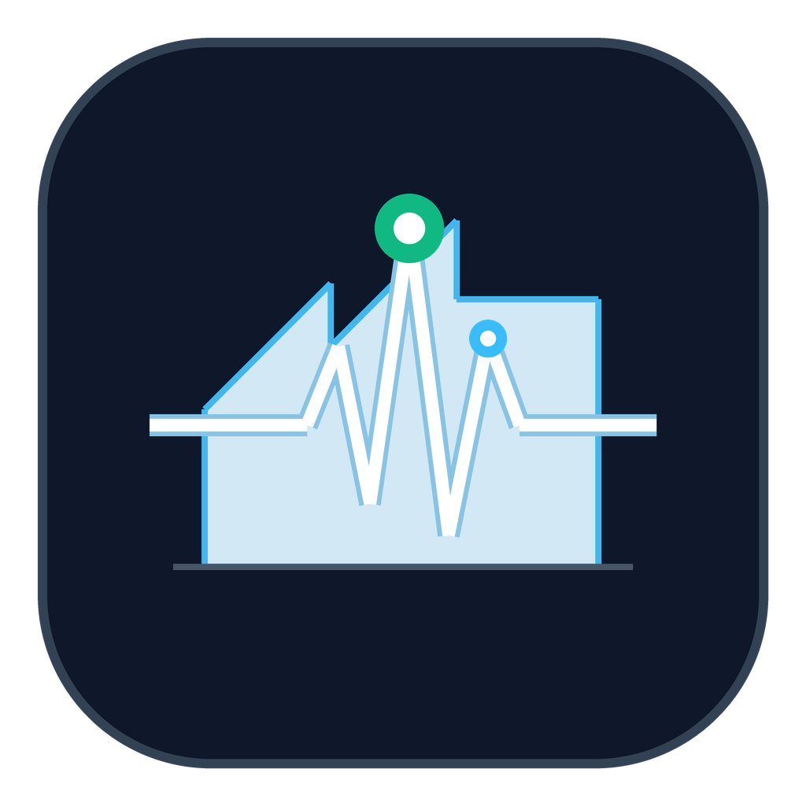
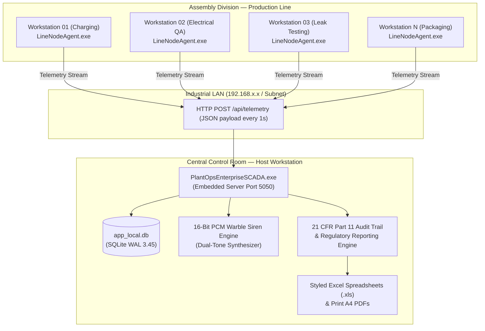

# PlantOps™ Enterprise SCADA & Line Node Telemetry System

<p align="center">
  
  <br/>
  <b>High-Performance Industrial Supervisory Control, Data Acquisition &amp; Workstation Telemetry System</b>
  <br/>
  <i>Engineered for Assembly Plants, Production Lines &amp; Smart Manufacturing</i>
</p>

<p align="center">
  
  
  
  
  
  
  
</p>

---

## 📌 Executive Summary

**PlantOps™ Enterprise SCADA** is a production-grade industrial monitoring suite developed in **C# .NET 8 WPF**. It provides real-time situational awareness, hardware telemetry collection, cryptographic parameter breach tracking, and automated reporting across discrete manufacturing assembly lines (e.g. RAC / HVAC, electronics, automotive).

The solution comprises two unified core applications:
1. **PlantOps™ Enterprise SCADA Central Server (`PlantOpsEnterpriseSCADA.exe`)**:
   - Master supervisory control room dashboard with embedded asynchronous HTTP telemetry server (Port 5050).
   - High-performance SQLite WAL database engine.
   - Situational awareness HMI meeting **ISA-101.01** and **ISO 11064** control centre standards.
   - Dual-mode industrial emergency alert engine (16-bit 22,050 Hz PCM dual-tone warble synthesizer with hardware beep fallback).
   - Tamper-evident parameter breach tracking with dual **Excel XML/HTML (.xls)** and **A4 Print PDF** export routines compliant with **FDA 21 CFR Part 11**.

2. **PlantOps™ Line Node Agent (`LineNodeAgent.exe`)**:
   - Lightweight shop-floor workstation client service running 24/7 in the Windows system tray.
   - Native WMI & Performance Counter collector: CPU Physical Load, RAM Working Set Commit, CPU Thermal Temperature, Drive Free Space, Network Latency, Active Operator Session, USB Peripherals, and Temp/Prefetch accumulation.
   - Automatic resilient reconnection loop: zero manual restarts needed on physical network disconnections.

---

## 🏛️ System Architecture



---

## ✨ Key Capabilities

| Dimension | Enterprise Feature |
| :--- | :--- |
| **Real-Time Telemetry** | 1-second continuous sampling of CPU %, RAM %, Thermal °C, Disk Free GB, Network Ping, and Peripherals. |
| **Situational HMI** | ISA-101 high-contrast situational indicators with Light / Dark theme support, borderless local time clock, and unified network pills. |
| **Resilient Reconnection** | Exponential backoff retry loop; automatically recovers from network disconnects without agent restart. |
| **Industrial Audio Alert** | Custom synthesized 16-bit 22,050 Hz PCM oscillating warble siren (`1050 Hz ± 350 Hz @ 4 Hz`) with `Console.Beep` fallback. |
| **Regulatory Compliance** | **FDA 21 CFR Part 11** electronic record retention, cryptographically referenced incident logs, and supervisor sign-off sections. |
| **High-DPI Awareness** | **PerMonitorV2** application manifests for razor-sharp rendering on 4K monitors and industrial touchscreen HMIs. |
| **Zero-Configuration Deployment** | Published as self-contained, single-file win-x64 executables with zero external runtime dependencies. |

---

## 📂 Repository Directory Structure

```text
├── .github/
│   └── workflows/
│       └── build-and-release.yml   # Automated GitHub CI/CD build & release pipeline
├── DotNetApp/                       # Central SCADA Server & WPF Dashboard
│   ├── App.xaml / App.xaml.cs      # Single-instance mutex & startup lifecycle
│   ├── app.manifest                # PerMonitorV2 High-DPI & Windows 10/11 manifest
│   ├── Data/                       # SQLite database engine & schema migrations
│   ├── Models/                     # Station, Telemetry, Breaches & Network profiles
│   ├── Services/                   # ScadaHttpServer, AudioAlertService, CsvExportService
│   ├── ViewModels/                 # MainViewModel, StationCardViewModel, RelayCommands
│   └── Views/                      # MainWindow, AuditLogWindow, SettingsDialog, AboutDialog
├── LineNodeAgent/                   # Shop-Floor Workstation Agent Client
│   ├── App.xaml / App.xaml.cs      # Workstation background service & tray hooks
│   ├── app.manifest                # High-DPI & execution privileges manifest
│   ├── Data/                       # Local SQLite configuration cache
│   ├── Services/                   # WmiTelemetryService, TelemetryWorker
│   ├── ViewModels/                 # MainViewModel (metrics & streaming loop)
│   └── Views/                      # MainWindow, InstallationWizardWindow, AboutDialog
├── DotNetInstaller/                 # Enterprise Setup & Deployment Wizard
├── DotNetSimulator/                 # 6-Station Industrial Telemetry Simulator
├── docs/                           # Technical documentation & firewall guides
├── WINDOWS_INSTALLERS/              # Packaging scripts, batch automation & icon assets
├── PlantOps_Enterprise_SCADA.sln   # Visual Studio Solution File (.NET 8.0)
├── LICENSE.txt                     # Open source license
├── .gitignore                      # Configured to exclude binaries (>100MB)
└── README.md                       # Project documentation
```

---

## 🚀 Getting Started

### Prerequisites
* Windows 10 (Build 19041+) or Windows 11 (x64)
* [.NET 8.0 SDK](https://dotnet.microsoft.com/download/dotnet/8.0) (for building from source)
* Visual Studio 2022 (v17.8+) or Visual Studio Code with C# Dev Kit

### 1. Clone the Repository
```bash
git clone https://github.com/<YOUR_USERNAME>/PlantOps-Enterprise-SCADA.git
cd PlantOps-Enterprise-SCADA
```

### 2. Build the Solution
```bash
dotnet restore PlantOps_Enterprise_SCADA.sln
dotnet build PlantOps_Enterprise_SCADA.sln -c Release
```

### 3. Publish Single-File Self-Contained Binaries
To build zero-dependency single-file executables:

```powershell
# Publish Central SCADA Server
dotnet publish DotNetApp/DotNetApp.csproj -c Release -r win-x64 --self-contained true -p:PublishSingleFile=true -p:IncludeNativeLibrariesForSelfExtract=true -o Release_ScadaDashboard

# Publish Line Node Agent
dotnet publish LineNodeAgent/LineNodeAgent.csproj -c Release -r win-x64 --self-contained true -p:PublishSingleFile=true -p:IncludeNativeLibrariesForSelfExtract=true -o Release_LineNodeAgent
```

---

## 🌐 Telemetry API Specification

The embedded SCADA server listens on Port `5050` by default.

### `POST /api/telemetry`
Workstation agents transmit live telemetry samples via JSON POST requests.

**Request Payload:**
```json
{
  "station_id": "LINE1_STATION_06",
  "station_name": "ST-06: Final QA Run-Test",
  "hostname": "WORKSTATION-06",
  "ip_address": "192.168.19.106",
  "status": "NORMAL",
  "system_telemetry": {
    "cpu_percent": 14.5,
    "ram_percent": 52.8,
    "cpu_temp_celsius": 43.0,
    "disk_free_gb": 184.2,
    "latency_ms": 2.4,
    "uptime_hours": 18.5,
    "temp_junk_files": 12,
    "active_user": "operator_qa",
    "usb_peripherals_count": 3
  },
  "permissions": {
    "cpu": true,
    "ram": true,
    "temp": true,
    "disk": true,
    "allow_remote_stop": true
  }
}
```

**Response:**
```json
{
  "status": "ok",
  "station_id": "LINE1_STATION_06"
}
```

### Additional Endpoints
* `GET /api/stations` — Query registered workstations and current health state.
* `GET /api/downtime-logs` — Query threshold breach audit trail.
* `GET /api/health` — Engine heartbeat check (`200 OK`).

---

## 🛡️ Standards & Regulatory Compliance

* **FDA 21 CFR Part 11**: Immutable audit logs, electronic timestamps in local station time, and non-repudiation records for manufacturing deviations.
* **ISA-101.01**: High-performance Human Machine Interfaces (HMI) for situational awareness, color ergonomics, and alarm suppression.
* **ISO 11064**: Ergonomic layout of control centres and industrial display metrics.

---

## 📄 License

This project is licensed under the [MIT License](LICENSE.txt).

---

<p align="center">
  <b>PlantOps™ Industrial Automation Solutions</b><br/>
  <i>Engineered for Reliability, Performance &amp; Compliance</i>
</p>
